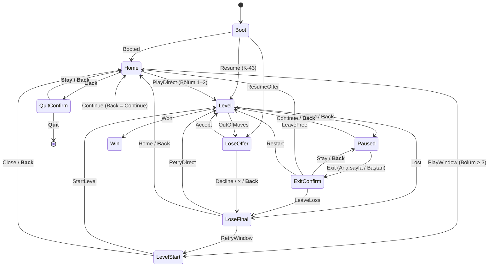

# UX_UNITY — Unity yapısı UX şartnamesi (paket U1)

> **Şablon:** UX Spec (çok ekranlı akış + HUD + kalıp kütüphanesi; stüdyo `ux-design` ve `design-system` yöntemi)
> **Durum:** Taslak v1 — orkestrasyonlu koşu, onay beklemeden yazıldı (brif hedef yolu verdi); kararlar §2'de gerekçeli
> **Yazar:** design-lead (stüdyo rolü `ux-designer` + `accessibility-specialist`) · **Tarih:** 2026-11-08
> **Platform hedefi:** mobil dokunmatik, dikey (WebGL önizleme + Android; iOS sonra). Klavye/gamepad kapsam dışı; Android
> geri tuşu ve tarayıcı Esc kapsamda. **Erişilebilirlik katmanı:** Standard (renk + simge, metin ≥ 4,5:1, ≥ 34 px,
> hareketi azalt, odak sırası gerekmez — dokunmatik).
> **Dayandığı belgeler (salt okunur, web reposu):** `docs/UX_FLOWS.md` (§0 ölçü sistemi, §5 oyun ekranı, §13 öğretici),
> `docs/JUICE.md`, `docs/ART_REFERENCE.md` (§10 rubrik, §11 kopya sınırı), `docs/GDD.md` (K-29, K-39, K-52, K-53).
> **Kanıt:** `docs/review_inbox/ux-audit.md` (UX-01…UX-24; ci-shots `8af961b`).
> **Bu belge ne değildir:** sanat tarifi (ART_UNITY / ART_3D) ve oyun kuralı (GDD). Çakışmada kural GDD'nin, görünüş
> ART'ındır; bu belge bölge, ölçü, durum, akış ve davranış verir.

## 1. Amaç ve oyuncu yolculuğu

**Oyuncu ihtiyacı:** "Açar açmaz bir bulmacaya girmek, ne yapacağımı tek bakışta görmek, yanlışımı cezasız düzeltmek ve
her doğru hamlede ödüllendirildiğimi hissetmek."

| Yolculuk anı | Oyuncunun durumu | Ekran | UX sözü |
|---|---|---|---|
| İlk açılış | meraklı, sabırsız | Yükleme → Ana ekran | ≤ 1 dokunuşla Bölüm 1 (ölçülen: 1) |
| İlk bölüm | öğreniyor | Oyun + öğretici | el + tek cümle; hiçbir şey kilitlenmez (K-53) |
| Doğru yerleşim | küçük zafer | Oyun | katmanlı geri bildirim (JUICE #12) |
| Kazanma | gururlu | Kazanma penceresi | ödül görünür, tek CTA |
| Hamle bitti | hayal kırıklığı | Kaybetme | suçsuz dil, eşit seçenekler (K-29, R-15) |
| Ara verme | dikkati bölünmüş | Duraklat / Çıkış onayı | onaysız kayıp yok |

## 2. Kararlar (seçenekler → seçim → gerekçe)

### K1 — Ölçek kipi (UX-01)
| Seçenek | Artı | Eksi |
|---|---|---|
| A. FIT (bugün) | düzen her ekranda aynı | 390×844'te %18, 360×800'de %20 ölü bant; alt grup 75 pt yukarıda |
| **B. EXPAND (1920–2400)** | tam ekran; tahta ve alt grup aşağı iner (başparmağa yakın); web D-015 | ana sayfa arka planı satır germesi ister (var) |
| C. UI FIT + arka plan taşar | bant görünmez | dokunma bölgeleri yine yukarıda; iki koordinat sistemi |

**Seçim: B.** Çapa sözleşmesi hazır (`LayoutSettings`: üst grup üstten, alt grup alttan, tahta `(H−1920)×0,5`), CI
`expand/` kareleri doğru çalıştığını gösteriyor. H > 2400 (21:9 ve üstü) ise kalan fark üst/alt eşit bant olur.

### K2 — Öğretici balonunun yeri (UX-11)
| Seçenek | Artı | Eksi |
|---|---|---|
| A. Üst dok (bugün) | HUD'a yakın, sabit | elden 330–560 px uzak; göz iki yere gider |
| **B. Tahta üstü dok** (vinç alanı üstü − 16 px), kuyruk eldivenin x'inde | el ile balon tek bakışta; tahtayı örtmez; boş şeridi kullanır | hedef paneli vurgusunda kuyruk uzar |
| C. Eldivenle yürüyen balon | en yakın | tahtayı örter, hareket eder, okunması zor |

**Seçim: B**, istisna: adımın vurgusu HUD'daysa (`goals`, `panorama`) A kullanılır (UX_FLOWS §13.1 "kuyruk yukarı").

### K3 — Kilitli güçlendirici yuvaları (UX-10)
| Seçenek | Artı | Eksi |
|---|---|---|
| A. 4 yuva hep görünür, kilitli (bugün) | yer sabit (ilke "yerler değişmez") | Bölüm 1'de 4 ölü düğme; "Geri Al kilitli" = "hata affedilmez" |
| B. Yuva açılış bölümünde belirir | sade | sürpriz, bekleme hissi yok |
| **C. Yuva açılıştan 2 bölüm önce belirir**, kilitliyken altında "Bölüm N" + dokununca ipucu | merak + sade FTUE | yuva sırası bölümle değişir |

**Seçim: C.** Yuvalar her zaman sabit sırada ve sabit x'te çizilir (Çekiç, Vinç, Fırça, Geri Al); görünmeyen yuvanın
yeri boş kalır (komşular kaymaz). Açılışlar (economy.json): Çekiç 8, Vinç 10, Geri Al 13, Fırça 22 → Bölüm 1–5'te hiç yuva
yok, 6'da Çekiç belirir. Envanterinde adedi olan yuva (sandık/günlük ödül) bölümden bağımsız görünür (UX_FLOWS §0.3).

### K4 — Ana ekran kilitli sekmeleri (UX-06)
A. **Göster: ikon %55 + kilit + soluk ad + dokununca "Yakında"** · B. Gizle, açıldıkça ekle · C. Tek "Yakında" sekmesi.
**Seçim: A** — UX_FLOWS §2.2 madde 11 kararıyla uyumlu (alt çubuk ilk açılıştan görünür), eksik olan yalnız ad ve dokunuş
geri bildirimi.

### K5 — Geri tuşu ana ekranda (UX-02)
A. Hiçbir şey · **B. "Oyundan çıkılsın mı?" onayı (Kal / Çık)** · C. Uygulamayı arka plana al.
**Seçim: B** (P4B-17 ile aynı). C Android'e özgü Java çağrısı ister; A tuşu "bozuk" hissettirir.

### K6 — Ölü dokunuş politikası (UX-04)
**Kural:** Ekranda dokunulabilir görünen (hacimli, kontürlü, ikonlu) her öğe **100 ms içinde** görünür bir tepki verir:
etkin ise eylem; kilitli/hedefsiz ise `LockedHint` (§5.9). Seçenekler (A: tepki yok, B: yalnız ses, C: görsel + ses)
içinden **C** seçildi; ses `sfx_locked` yoksa `sfx_cancel` (JUICE #8).

## 3. Ekran akış haritası (durum makinesi)

`Flow/ScreenFlow.cs` tablosu + bu belgenin eklediği **geri** olayları (kalın).

**Ayarlar** bir kaplamadır (Home ya da Paused üstünde; `Flow.SettingsOpen`): Back / × / Tamam → altındaki ekran.
**Geri yığını kuralı:** Back her zaman en üstteki pencereyi kapatır ve "hayır/kal" anlamındaki seçeneği seçer; hiçbir
Back bir kaynak harcamaz (can, altın) ve hiçbir Back ödül penceresini atlatmaz (Win'de Devam ile aynı). Geçiş ve kilitli
animasyon sırasında (UX_FLOWS §0.3 R-12 listesi) Back kuyruğa girer, animasyon bitince işler.

## 4. Ekran şartnameleri

Koordinatlar 1080 × H tasarım px; **H = 1920 (FIT) değerleri verilir**, EXPAND'de: üst grup aynı, alt grup `H − (1920 −
y)`, tahta grubu `+ (H − 1920) × 0,5`, pencere alt kenarı `H − 296`. 1 pt ≈ 2,77 px (390) / 3,0 px (360).

### 4.1 Ana ekran (Home)

**Oyuncu buraya gelir ki:** sıradaki bölümü oynasın; ilerlemesini görsün. **Gelişi:** ilk açılış, kazanma/kayıp sonrası.

| Bölge | y (FIT) | Öğeler (öncelik) | Ölçü |
|---|---|---|---|
| Üst çubuk | 84–212 | Can kapsülü (5 / "Dolu"), Altın kapsülü + "+", Ayar dişlisi | kapsül 300×88 (x 160 / 500, y 104); dişli 128×128 (x 908, y 84) |
| Başlık | 196–430 | Logo (P2: yükleme ekranına taşınır) | sözcük işareti, y 196 |
| İlerleme | 440–650 | Alan kurdelesi "Ağaç Ev" (620×120, y 440), ★ çubuğu "0/10" (480×84, y 566) + **(P1) alt satır** | alt satır 34 px, y 660 |
| Sahne | 600–1340 | Usta Kral (dokunulabilir: selam), Tuna, Kepçe, yapı | — |
| **Birincil eylem** | 1384–1584 | **Oyna · Bölüm N** (yeşil) | 660×200 |
| Alt gezinme | 1704–1920 | 5 sekme; orta "Ana Sayfa" seçili yükseltilmiş | çubuk 1080×216; seçili sekme 300×300 (y 1620); ad etiketi 40 px |

**Hiyerarşi:** 1 Oyna → 2 ilerleme (★ çubuğu) → 3 karakterler → 4 kaynaklar → 5 sekmeler.
**Durumlar:** Varsayılan · İlk açılış (★ 0/10, sekmeler kilitli) · Can 0 (Oyna → can penceresi, Faz 4; bugün yok) ·
Tüm bölümler bitti (`home.moreSoon`, Oyna gri + "Yeni bölümler yolda") · Yükleniyor (§5.12) · Kayıt bozuk (`FromBackup`:
1,5 s şerit "Kayıt yedekten açıldı", oyun sürer).
**Etkileşim:** Oyna → PlayDirect/PlayWindow · dişli → Ayarlar · Kral → selam (KingDirector) · kilitli sekme / "+" / can →
`LockedHint` "Yakında" (K6) · Back → QuitConfirm (K5).
**Metin sınırı:** `home.playLevel` ≤ 16 karakter (TR "Oyna · Bölüm 50" 15); sekme adı ≤ 10 (TR), ≤ 10 (EN).

### 4.2 Oyun ekranı ve HUD (Level)

**Oyuncu buraya gelir ki:** planı bloklarla doldursun. **Gelişi:** Home (1–2), LevelStart, Resume.

| Bölge | y (FIT) | Öğeler | Ölçü (P0 değişikliği kalın) |
|---|---|---|---|
| HUD satır 1 | 24–84 | Bölüm kapsülü (220), Kalan blok çipi (ikon + sayı 44 px + "blok"), Usta Serisi (etiket + 4 boncuk + mala ×n) | h 60; etiketler **34 px** (bugün 30–32) |
| HUD satır 2 | 112–**288** | **Hedef kartı** (ad + ★ + plan küçük resmi) · HAMLE plakası · Duraklat | hedef kartı **340×176** (bugün 300×136), ad **36 px** (bugün 28), plan hücresi **36 px**; HAMLE 300×136, etiket **34 px**, sayı 80–96 px; Duraklat 136×136 (x 896) |
| Balon şeridi | 304–**635** | Öğretici balonu (K2 B), bağlamsal satırlar, ipucu şeridi | balon ≤ 640×≥ 104, portre 128; alt kenar = vinç alanı üstü − 16 |
| Tahta grubu | ~651–1488 | Vinç alanı, saha (sol), duvar/geçit, şantiye (sağ), plan | hücre 120–144; pay 30 |
| Durum şeridi | 1520–1600 | şantiye kurdelesi / kamyon çipi | h 80 |
| Alt grup | 1600–1896 | Kral köşesi (sol, 280×296) + Kepçe, güçlendirici yuvaları (K3) | yuva 160×160, aralık 32, x 304'ten; alttan 120 |

**Hiyerarşi (ilk 5 sn):** 1 tahta + öğretici eli → 2 HAMLE sayısı → 3 hedef kartı (plan) → 4 kalan blok → 5 seri.
**Durum görünürlüğü:** her hamle sonunda HAMLE −1 (JUICE tick 150), kalan blok −1, plan hücresi dolar (#12); son 3
hamlede plaka nabız + `tut.ctx.lastmoves` (bir kez). Renk dışı ipuçları: blok sembolü (●●● nokta, ≋ dalga…), gölgede ✓ / !
rozeti, sıradaki satır beyaz çerçeve.
**Durumlar:** Normal · Öğretici adımı etkin (Gösterim / Gizli) · Sürükleme · Kilitli animasyon (dilim 600, kamyon 700,
Söküm 600; dokunuş 3× hızlandırır) · Son hamleler (≤ 3) · Bonus İnşaat (kazanmadan sonra) · Devam (Resume: Duraklat açık
gelir, JUICE #87).
**Etkileşim:** blok sürükle (§6.2) · Duraklat / Back → Paused · güçlendirici yuvası: hazır → seçim kipi; hedefsiz → titreme
+ balon (UX_FLOWS §0.3); kilitli → `LockedHint` "{n}. bölümde açılır".
**Metin sınırı:** hedef kartı adı ≤ 22 karakter tek satır 36 px; aşarsa 2 satır 34 px (kısaltma "…" yok).

### 4.3 Bölüm başı penceresi (LevelStart, Bölüm ≥ 3)

`WindowFrame` (§5.6) + başlık "Bölüm N" (titleTwoRing 120 px) + gövde kartı: **plan küçük resmi ortada** (hücre 40 px,
P1; bugün sol kenarda), altında iki çip (hedef ×N, "N hamle"), "Güçlendiricileri seç" + 3 yuva (172×172; kilitliyse
"Bölüm 12/16/20"), Oyna 560×160 (y ≥ 1400), × 144 hedef. Back / × → Home (can ayrılmaz).

### 4.4 Duraklat (Paused)

Başlık "Mola"; seçenekler alttan üste: **Devam** (yeşil, en altta, 920×152) · Bölümü baştan başlat (krem + ↻ ikonu, P1) ·
Ana sayfa (krem + ev ikonu, P1); dişli panel sağ üst köşesinde (128). × yok (Devam + Back yeterli). Ana sayfa ve Baştan
başlat **her zaman** Çıkış onayına gider.

### 4.5 Çıkış onayı (ExitConfirm)

Başlık `exit.title`; gövde: Kral "düşünüyor" + 1–2 satır (`exit.free` ya da `exit.cost` + `exit.streak`); `EqualPair`
**Kal** (yeşil, solda) / **Çık** (krem — kırmızı değil, suçlayıcı renk yok; bugün `ButtonKind.Danger`, P1 krem). Back = Kal.

### 4.6 Kazanma (Win)

Karartma #05030D α 0,85 → ışın yelpazesi → "Kazandın!" altın kurdele → yıldız (glow) → `win.clear` → yapı kartı (Kral sevinç
+ tamamlanan plan + yapı adı + "Yapı tamam!") → ödül satırı (+altın, +★) → Bonus/Mala satırları → **Devam** 560×160 (y ≥
1400). Devam'a dokunmadan önce ≥ 600 ms giriş (yanlışlıkla atlama yok). Back = Devam. Metin: `win.bonus` P1'de "Bonus
İnşaat · {n} hamle → altın" anlamına çekilir (UX-16; içerik sahibi).

### 4.7 Kaybetme ve +5 teklifi (LoseOffer / LoseFinal)

`OfferWindow` (R-15): başlık `lose.title`; Tuna/Kral düşünceli + "Kalan: N blok" + kalan plan küçük resmi; seçenekler eşit
920×152 alttan üste: **"+5 hamle" + `PriceLabel`** (turuncu) · "Reklam izle · +5" (krem; **reklam yoksa satır gizli**, P1) ·
"Hayır, teşekkürler" (krem). × = Hayır. Geri sayım, nabız, "son şans" yok. "Teklif n/3" satırı yalnız n ≥ 2 (P1, ürün onayı).
LoseFinal: "Bir can gitti." + Tekrar dene (yeşil) + Ana sayfa (krem). Back = Hayır (Offer) / Ana sayfa (Final).

### 4.8 Ayarlar (kaplama)

Satır 920×128 (her satırın **tamamı** dokunma hedefi; anahtar yalnız göstergedir): Ses · Müzik (P1) · Titreşim ·
Hareketi azalt · Dil (`SegmentedPill`: Türkçe / English) · (P2) Büyük yazı. Tamam (yeşil) + × (ikisi de kapatır; bilinçli
çift, R-15 × kuralıyla tutarlı). Değişiklik anında uygulanır ve kaydedilir (geri alma gerekmez: her anahtar kendi tersidir).

## 5. Bileşen kütüphanesi

Görünüş ART_UNITY §4.4 / ART_REFERENCE §3 kitinden; burada **ölçü, durum, davranış**. Ad = koddaki karşılığın hedef adı.

| # | Bileşen | Ölçü (min) | Durumlar | Davranış |
|---|---|---|---|---|
| 5.1 | `PrimaryButton` (yeşil) | 560×160 (Oyna 660×200) | normal · basılı · pasif (gri, %55) · yükleniyor | basınca 10 px iner + 0,96 ölçek 80 ms, bırakınca 120 ms Back.easeOut; eylem **bırakınca** |
| 5.2 | `SecondaryButton` (turuncu, satın alma) | 400×144; teklifte 920×152 | + `PriceLabel` | aynı |
| 5.3 | `NeutralButton` (krem) | ikincil ile aynı boy | aynı | aynı; "Hayır", "Çık", "Ana sayfa" |
| 5.4 | `SegmentedPill` | satır içinde, her hap ≥ 128 h, **genişlik ≥ metin + 2×16 + bayrak 60** | seçili (mavi) · seçili değil (krem) | dokununca anında seçilir |
| 5.5 | `ToolButton` (mor, duraklat/ayar) | 128–136 kare | normal · basılı | aynı basma; üst köşelerde |
| 5.6 | `WindowFrame` | panel 1000 genişlik, alt kenar H − 296 | açılış/kapanış | başlık şeridi üst kenarda; seçenekler alttan üste, aralık 24, alt pay 64; açılış 220 ms Back.easeOut, karartma %55 180 ms (JUICE #70) |
| 5.7 | `CloseButton` (kırmızı ×) | Ø 112 görsel + pay = 144 hedef (Unity bugün 136×136, P1: 144) | normal · basılı | panel sağ üst köşesine 40 px taşar; = "Hayır/Kal" |
| 5.8 | `EqualPair` | 2 × 440×152, aralık 40 | — | R-15 eşitlik; olumlu solda |
| 5.9 | `LockedHint` | balon ≤ 520×104, hedefin üstünde 16 px | gösterim 1200 ms | kilit 3× ±6° sallanır (JUICE #73) + `sfx_cancel`; metin `common.unlockAt` / `common.comingSoon`; aynı anda tek balon |
| 5.10 | `Capsule` (HUD/üst çubuk) | h 60 (HUD), 88 (ana) | normal · nabız · artış | sayı değişince 150 ms tick; ikon kapsülün sol ucundan taşar |
| 5.11 | `CounterPlate` (HAMLE) | 300×136 | normal · son 3 (nabız + altın kenar) · 0 | sayı 80–96 px `Big` |
| 5.12 | `GoalCard` (hedef kartı) | **340×176** | normal · güncelleme (hücre dolar) · tamam (★ yanar) | plan küçük resmi canlı |
| 5.13 | `BoosterSlot` | 160×160 (pencerede 172) | gizli · kilitli (+ "Bölüm N" 34 px) · hazır (adet rozeti) · adet 0 ("+") · hedefsiz (gri) · seçili (ışıma) | öncelik: kilitli > hedefsiz > adet 0 (UX_FLOWS §0.3) |
| 5.14 | `NavTab` | 216 h (1080/5 = 216 genişlik); seçili 300×300 | seçili · normal · kilitli (ikon %55 + kilit 48 + ad soluk) | kilitli → `LockedHint` "Yakında" |
| 5.15 | `TutorialBubble` | ≤ 640 × ≥ 104, r 36, portre 128 | gösterim · gizli · sürüklemede α 0,35 | dokunuş almaz (altına geçer); ≤ 6 kelime |
| 5.16 | `TutorialGlove` | 140×160 | drag · hold · tap | 1600 ms döngü + 400 ms bekleme; hayalet α 0,55 |
| 5.17 | `ProgressBar` (★ çubuğu) | 560×64 | dolum | artış 400 ms Quad.easeOut, uç ★ zıplar |
| 5.18 | `Strip` (bilgi şeridi) | 920×96 | 1500 ms | üstten iner; Resume, kayıt yedeği |
| 5.19 | `PriceLabel` | düğme içinde 2 satır | — | altın + "≈ 81 TL" (≥ 4,5:1) |
| 5.20 | `Toggle` | görsel 172×84, hedef = tüm satır | açık (yeşil) · kapalı (gri) | 160 ms kayma |

## 6. Etkileşim kalıpları

1. **Basma geri bildirimi:** her düğme ≤ 16 ms içinde basılı görünüme geçer; eylem bırakınca çalışır; parmak hedeften
   ≥ 30 px çıkarsa iptal (basılı görünüm 120 ms'de döner, eylem yok).
2. **Sürükleme:** tutunca blok %8 büyür, parmağın 1,2 hücre (fingerOffset 90 ms'de) üstüne çıkar, gölge düşer; şantiye
   üstündeyken düşüş gölgesi + ✓/! rozeti her zaman görünür (K-18); geçersiz bırakma = iptal (220 ms, 0 hamle; JUICE #8).
3. **Geri al:** sürükleme iptali ücretsiz ve her zaman var; hamle geri alma `BoosterSlot` Geri Al (K-39, açılış 13);
   Bölüm 1–12 için ürün sorusu §13 S2. Ayarlar anahtarları kendi tersidir.
4. **Onay:** kaynak kaybettiren her eylem (can, seri, altın) onay ister: çıkış (ExitConfirm), satın alma (fiyat düğmede
   yazılı = tek dokunuş onaydır; R-15). Ücretsiz eylem onay istemez.
5. **Geri / iptal:** §3 geri yığını. × = Back = "Hayır".
6. **Kaydırma:** bu yapıda kaydırılan liste yok; gelecekte (lig, mağaza) dikey, ataletli, en üste dokunma = başa dön.
7. **Animasyon sırasında girdi:** UX_FLOWS §0.3 R-12 (kilitli liste dışında bekleyen animasyon son karesine atlar).
8. **Ölü dokunuş yok:** K6.

## 7. Öğretici akışı (K-53: ≤ 2 adım, kaplama yok, girdi serbest)

Ortak: adım tahta etkileşime açıldıktan 600 ms sonra başlar; balon 220 ms belirir, 4000 ms görünür ya da doğru eylemde
200 ms'de söner; 4000 ms hareketsizlikte geri gelir (en çok 3 kez balonla, sonra yalnız el). Balon **K2-B** yuvasında
(vinç alanı üstü − 16 px; FIT'te y ≈ 515–635), kuyruk eldivenin x'ine; HUD vurgusunda üst dok (y 304–424). Kazanılmış
bölümde adım yok (K-53 madde 6).

| Bölüm · adım | Metin (TR / EN) | El | Balon | Vurgu | Bitiş |
|---|---|---|---|---|---|
| 1 · 1 | "Bloğu duvarın üstünden taşı!" / "Lift the block over the wall!" | `drag`: saha bloğundan dikey yukarı → vinç alanında sağa → duvar üstünden şantiye sütununa; noktalı iz; hayalet blok | tahta üstü, kuyruk tutma hücresinin x'i | blok kenarı + vinç alanı nabzı (8 px, 1200 ms) | doğru yerleşim |
| 1 · 2 | `tut.m.useall` "Bütün bloklar plana girecek." | yok | üst dok, kuyruk hedef kartına | hedef kartı + kalan blok çipi | bir sonraki doğru yerleşim |
| 2 · 1 | `tut.m.pattern` "Plan alttan üste dolar." | yok; hedef kartında alttan üste beyaz ok (64×40, 1200 ms) | üst dok | hedef kartı + şantiye | doğru yerleşim |
| 2 · 2 | `tut.m.shadow` "Gölgede {ok} varsa yer doğru." | `hold`: blok şantiye üstünde 600 ms bekler (✓ görünür), bırakır | tahta üstü | blok + şantiye | doğru yerleşim |
| 3 · 1 | `tut.m.dig` "Üsttekini sahada kenara çek." | `drag`: üstteki blok sahada yana (vinç alanına çıkmadan) | tahta üstü | üstteki blok + hedef hücre | `yardMove` (o blok) |
| 3 · 2 | `tut.m.free` "Şimdi alttakini taşı!" | yok | tahta üstü, kuyruk açılan bloğa | açılan blok nabız | doğru yerleşim |

Bölüm 3 ilk bölüm başı penceresidir; pencere kapanınca 600 ms sonra adım 1. Bağlamsal satırlar adım etkinken kuyrukta.

## 8. Bildirim ve ödül anları (RM kalıbı; yalnız kalıp, çizim değil — ART_REFERENCE §11)

| An | Kalıp | Katmanlar | Süre |
|---|---|---|---|
| Doğru yerleşim | yerinde patlama + sayaç tıkı | hücre dolar + flaş + 14 kıvılcım + `sfx_place_ok` (kombo perdesi) + hafif haptik | 200 (JUICE #12) |
| Seri boncuğu | HUD kapsülünde dolum | boncuk dolar + parıltı + ses | 160 |
| Dilim bitişi | şantiye kayar | kurdele + ses + haptik; girdi kilitli | 600 |
| Kazanma | karartma → başlık → nesne → ödül satırı → tek CTA | ışın, glow, konfeti, `sfx_win`, orta haptik | giriş ≤ 1500, CTA 600 ms sonra etkin |
| Ödül toplama | "dokun ve al" → üst çubuğa uçuş | uçan ikon + sayaç tıkırtısı | 900 (#74) |
| Kilit açılışı | yuva/sekme kilit kırılır | kilit düşer + ışıma + ses + `LockedHint` yerine "Yeni!" rozeti | 700 |
| Bilgi | `Strip` ya da Kral balonu | ses yok ya da yumuşak | 1500 / 2400 |

Kuyruk kuralı: aynı anda tek pencere, tek balon, tek şerit; öncelik Pencere > Söküm satırı > öğretici > bağlamsal > şerit.

## 9. Hareket ilkeleri (JUICE ile hizalı)

- **Ritim:** dokunuş tepkisi ≤ 80 ms; durum değişimi 150–350 ms; ödül 400–1500 ms; hiçbir zorunlu bekleme > 1500 ms
  (atlanabilir değilse).
- **Easing:** giriş `Back.easeOut` (pencere, balon), çıkış `Quad.easeIn`, yer değiştirme `Cubic.easeInOut`, sayaç `Expo.easeOut`.
- **Süreler:** pencere 220 / karartma 180 / balon 220–200 / iptal 220 / iniş 120 / doğru 200 / hatalı 350 / dilim 600 /
  kamyon 700 / kilit 700 / ipucu 1200.
- **Hareketi azalt (Ayarlar):** ölçek tepeleri ≤ 1,03, sallanma ve ekran sarsıntısı yok, parçacık ≤ %20, ışın yelpazesi
  durağan, geçişler 150 ms solma; oyun kuralı süreleri değişmez.
- **Geçişler:** Home ↔ Level 400 ms (solma + tahta düşüşü 400); pencere üst üste binmez (önce kapanır, sonra açılır).

## 10. Erişilebilirlik kuralları (Standard katman)

1. Metin ≥ 34 px (≈ 12 pt @390, 11,3 pt @360); sayaçlar ≥ 44 px. Kontrast: metin ≥ 4,5:1 (dolgu–zemin; kontur sayılmaz),
   büyük metin (≥ 56 px kalın) ≥ 3:1, UI öğesi ≥ 3:1.
2. Renk tek taşıyıcı değil: her blok rengi bir sembolle; ✓/! rozetleri; kilit simgesi; seçili sekme hem renk hem
   yükseklik.
3. Dokunma: ≥ 128 px her hedef, ≥ 144 px sık hedef (UX_FLOWS §0.1; 360'ta 42,7 dp bilerek kabul); bitişik hedefler
   arası ≥ 16 px.
4. Hareketi azalt anahtarı (§9). Titreşim anahtarı haptiği tümden kapatır.
5. Süre baskısı yok (G-H bölümleri hariç, "Zaman baskısını azalt" ile). Duraklat her zaman bir dokunuş (ve Back) uzakta.
6. Bilişsel: ekran başına tek birincil eylem; öğretici ≤ 6 kelime; ilk 5 bölümde görünür kilitli öğe ≤ 4 (alt gezinme).
7. Yazı boyu (P2): "Büyük yazı" ×1,15 gövde/etiket; 40 % TR→EN genişleme payı her etikette korunur.
8. Ekran okuyucu: kapsam dışı (WebGL/Unity UI); Android'de P2 (TalkBack etiketleri `UiNode.Label` → i18n anahtarı).

## 11. Metin stil rehberi (TR / EN)

- **Ses:** Usta Kral sıcak, kısa, saygılı; oyuncuya "usta" gibi davranır. **Hitap kelimesi yok** ("evlat", "kiddo",
  "yavrum", "dede" yok). Yaş anılmaz (D-044).
- **Uzunluk:** öğretici/balon ≤ 6 kelime; düğme ≤ 3 kelime (TR ≤ 18 karakter); başlık ≤ 3 kelime + "!" en çok bir.
- **Dil:** emir kipi tekil ("taşı", "bırak"), olumlu çerçeve ("Kalan: 4 blok", "Bir can gitti." — "Kaybettin" yok).
  Ünlem yalnız ödül ve öğretici eyleminde.
- **Büyük harf:** cümle düzeni ("Ana sayfa", sekmede de); `toLocaleUpperCase('tr-TR')` / C#'ta `ToUpper(new CultureInfo("tr-TR"))`.
- **EN:** düz, sıcak, kısa ("Out of moves!", "Stay" / "Leave"); TR'nin birebir çevirisi değil eşdeğeri.
- **Yeni anahtarlar (bu şartname):** `app.quit.title` "Oyundan çıkılsın mı?" / "Quit the game?" · `booster.lockedAt`
  "Bölüm {n}" / "Level {n}" · `home.progressHint` "{name} için {n} ★" / "{n} ★ for {name}". Düğmeler `exit.stay` / `exit.leave`
  yeniden kullanılır.
- **Düzeltilecek metinler (UX-24):** `tut.ctx.resume` "Tahta bıraktığın gibi duruyor." / "Just as you left it." ·
  `tut.ctx.support` "Önce alttaki boşluğu doldur." / "Fill the gap below first."

## 12. Öncelikli uygulama listesi

**P0 — U1'in uygulama paketi (code-lead; bu U1 paketinde kod değişmedi, yalnız şartname ve denetim yazıldı):**

| # | İş | Bulgu | Kabul |
|---|---|---|---|
| P0-1 | `LayoutSettings.Mode = Expand` varsayılan (K1) | UX-01 | 390×844 ve 360×800 karelerinde düz bant yok; alt grup alt kenardan 120 px |
| P0-2 | Android geri tuşu / Esc → §3 geri yığını; ana ekranda QuitConfirm (K5); `Screen.safeArea` içe çekme | UX-02 | her ekranda Back testi (NUnit `ScreenFlow` + Unity katmanı) |
| P0-3 | `LockedHint` (§5.9): kilitli sekmeler, altın "+", can kapsülü (Faz 4'e kadar "Yakında"), kilitli `BoosterSlot`; `LevelHud.BoosterTapped` bağlanır | UX-04 | görünür her dokunulabilir öğe ≤ 100 ms tepki (test: tüm `UiNode` düğmeleri tıklanınca olay ya da ipucu) |
| P0-4 | HUD metinleri ≥ 34 px: panorama adı 36, seri etiketi 34, HAMLE etiketi 34, mala adedi 34, segment 34 | UX-03 | `LevelHud` boyut testi: hiçbir `Label` < 34 |
| P0-5 | `GoalCard` 340×176, plan hücresi 36, `TopGroupBottomY` 304 | UX-09 | hedef kartı ile HAMLE plakası arası ≥ 24 px |
| P0-6 | Öğretici balonu tahta üstü dok (K2-B), kuyruk eldiven x'i; HUD vurgusunda üst dok | UX-11 | Bölüm 1 adım 1'de balon alt kenarı ile vinç alanı üstü arası 16 px; balon ile eldiven merkezi dikey mesafe ≤ 420 px |
| P0-7 | `BoosterSlot` görünürlük kuralı (K3) + "Bölüm N" etiketi | UX-10 | Bölüm 1–5'te yuva yok; Bölüm 6'da Çekiç kilitli + "Bölüm 8" |
| P0-8 | Kilitli `NavTab` adı görünür (soluk, 34 px) | UX-06 | 5 sekmenin 5'inde ad |
| P0-9 | `SegmentedPill` genişlik kuralı ("Türkçe" kırpılmaz) | UX-18 | metin kutusu ⊂ hap iç alanı, her yanda ≥ 16 px |
| P0-10 | `unity_tr.json` / `unity_en.json` üzerine yazma: `tut.ctx.resume`, `tut.ctx.support` (§11); yeni anahtarlar `app.quit.title`, `booster.lockedAt` | UX-24 | i18n denetimi: "evlat", "kiddo" geçmez; TR/EN anahtar eşleşmesi tam |
| P0-11 | CI `screens` setine `pause`, `exit_confirm`, `lose_offer`, `level_start` (Bölüm 3) kareleri | denetim kör noktası | 11 kare × 2 görünüm |

**P1:** UX-07 ilerleme alt satırı · UX-12 Kral konuşma pozu/portre · UX-13 seri ilk nabız · UX-14 parmak koordinatı
manifest'te · UX-16 `win.bonus` metni · UX-17 alt bilgi kontrastı · UX-19 Müzik satırı · UX-20 duraklat ikonları ·
UX-21 bölüm başı plan ortada · UX-22 reklam yoksa satır gizli · UX-23 "Teklif n/3" yalnız n ≥ 2 (ürün onayı) · Çık düğmesi
krem · "Ana sayfa" büyük harf birliği · cihazda ilk açılış süresi ölçümü (WebGL 21,5 MB, §14 AC-2).
**P2:** "Büyük yazı" ayarı · logo yükleme ekranına, ana ekranda yapı kartı · sol el modu · yüksek kontrast · TalkBack
etiketleri.

## 13. Açık sorular (sahibine göre)

- **S1 (orkestratör):** K1 EXPAND varsayılanı — CI.md "karar orkestratörün" diyor; bu şartname B'yi öneriyor.
- **S2 (product-lead):** Bölüm 1–12'de Geri Al yok (açılış 13). Hata affediciliği için öneri: Bölüm 1–12'de **bölüm başına
  1 ücretsiz Geri Al** (yuva görünmez; yanlış bırakmadan sonra 3 s "Geri al" `Strip` düğmesi). Alternatif: hiçbir şey
  (sürükleme iptali + Söküm yeterli sayılır).
- **S3 (product-lead / entrepreneur):** "Teklif n/3" satırı ilk teklifte gizlensin mi (UX-23)?
- **S4 (içerik):** Usta Kral EN adı açık (ART_3D §13.1); balon portresi adı göstermez, etkilenmez.

## 14. Ölçülebilir kabul ölçütleri

| # | Ölçüt | Ölçüm |
|---|---|---|
| AC-1 | İlk açılıştan Bölüm 1 tahtasına **≤ 3 dokunuş** (bugün 1) | `GameApp.Taps` sayacı, NUnit akış testi |
| AC-2 | İlk açılıştan Bölüm 1 etkileşimine **≤ 10 s** (kurulu Android, orta telefon); WebGL ilk ziyaret ayrı raporlanır | cihaz ölçümü (P1) |
| AC-3 | Her dokunma hedefi ≥ 128 px; sık hedefler (§0.1 listesi) ≥ 144 px | `UiNode` ağacı taraması testi |
| AC-4 | Her metin dolgu–zemin kontrastı ≥ 4,5:1 (büyük ≥ 3:1) | ekran görüntüsü örneklemesi (bu denetimdeki yöntem) |
| AC-5 | Hiçbir metin < 34 px | `Label` boyut testi |
| AC-6 | Her ekranın birincil eylemi y ≥ 1400 (FIT) / ≥ H − 520 (EXPAND), yükseklik ≥ 144 | düzen testi |
| AC-7 | Back her ekranda tanımlı ve kaynak harcamaz | `ScreenFlow` tablo testi |
| AC-8 | Ölü dokunuş 0 (her düğme eylem ya da ipucu) | düğüm tarama testi |
| AC-9 | Öğretici: bölüm başına ≤ 2 adım; karartma α = 0; adım sırasında tüm bloklar tutulabilir | K-53 testleri |
| AC-10 | Pencere açılışı ≤ 220 ms, dokunuş tepkisi ≤ 80 ms (60 FPS'te ≤ 5 kare) | JUICE süre testi + perf |
| AC-11 | Hareketi azalt açıkken ölçek tepesi ≤ 1,03, sallanma yok | FeelSettings testi |
| AC-12 | 360×800'de yatay taşma / kırpılan metin yok | CI kareleri + metin kutusu testi |
| AC-13 | TR/EN anahtar eşleşmesi tam; "evlat/kiddo/dede" geçmez | i18n testi |
| AC-14 | Denetim rubriğinde her boyut ≥ 4/5 (ux-audit §3) | design-lead yeniden incelemesi |
